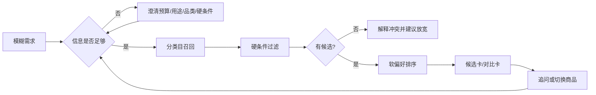

# 交互原型（低保真）

## 1. 页面结构

```text
┌─────────────────────────────────────┐
│ 多品类智能导购          [新会话]    │
├──────────────┬──────────────────────┤
│ 品类入口      │ 对话区               │
│ 鞋履          │ 助手：想买什么？      │
│ 服饰          │ 用户：送朋友，800内   │
│ 数码          │ 助手：用途/品类追问    │
│ 最近会话      │ [运动] [通勤] [继续]   │
│               │ ┌商品卡───────────┐  │
│               │ │图  名称  价格    │  │
│               │ │依据/更新时间     │  │
│               │ │[详情][对比][换一件]│  │
│               │ └─────────────────┘  │
│               │ [输入框……] [发送]    │
└──────────────┴──────────────────────┘
```

移动端采用单列：顶部品类/会话切换，消息流中嵌入卡片，底部固定输入框和快捷追问。

## 2. 关键状态

| 状态 | 用户可见表现 | 可执行动作 |
|---|---|---|
| 空会话 | 展示三类入口和示例问题 | 选择品类、点击示例、输入问题 |
| 澄清中 | 助手问题 + 快捷选项 | 选择选项或自由输入 |
| 查询中 | “正在查找商品/规格”及进度 | 取消、继续等待 |
| 部分结果 | 文本先到，卡片随后到 | 查看已返回内容 |
| 有结果 | 候选/规格/对比卡 | 详情、对比、换一件、追问 |
| 无匹配 | 说明冲突条件 | 放宽预算/尺码/兼容条件 |
| 无法核实 | 显示缺失来源或过期信息 | 查看来源、人工核实、换问题 |
| 失败 | 明确错误，不丢失会话 | 重试、重新开始 |

## 3. 核心流程



## 4. 示例对话

**用户**：想给喜欢跑步的朋友买礼物，预算 800 元。

**助手**：预算收到。还需要确认两个点：偏鞋履、服饰还是数码？朋友平时是公路跑还是日常健身？

**用户**：日常健身，鞋子，平时穿 42 码。

**助手**：我会按“鞋履、42 码、800 元内、日常健身”筛选。以下商品的尺码和库存来自当前数据快照；如果某条没有 SKU 级信息，我会标记为“无法核实”。

[候选商品卡] [查看详情] [比较]

**用户**：第二件和第一件有什么不同？

**助手**：[对比卡] 价格、用途、材质、尺码可用性、依据时间；逐字段显示“已核实/缺失/无法核实”。

## 5. 原型验收点

- 三类入口进入同一个会话模型，当前品类始终可见。
- 卡片只显示数据中真实存在的字段；没有来源或已过期字段不生成肯定性结论。
- 点击“对比”至少选择两件同品类商品；跨品类比较转为差异维度说明或澄清。
- 超时、无候选、数据缺失都有可恢复动作，且不清空已确认约束。


## 6. UI 选型与详情页（已确认）

使用 React + TypeScript + Ant Design，移动优先、桌面响应式。采用 Card、List、Input、Button、Tag、Alert、Drawer 和 Table 等常规组件；窄屏对比使用纵向字段布局。前端消费后端结果，不承担推荐或事实判断。

商品卡“详情”进入项目内详情页，展示商品属性、规格、字段来源、更新时间及无法核实项；可从详情发起咨询并携带当前商品 ID，返回时保留会话。存在已核实外链时提供“查看来源”。

P0 展示等待、完整结果、错误和重试；部分结果与流式文字列入 P1。原型中的查询进度仅在真实收到对应事件时展示，不模拟后端执行状态。
