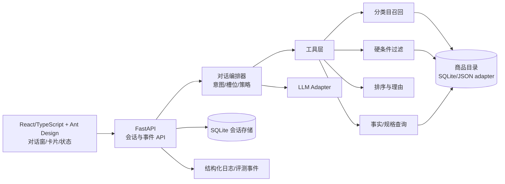
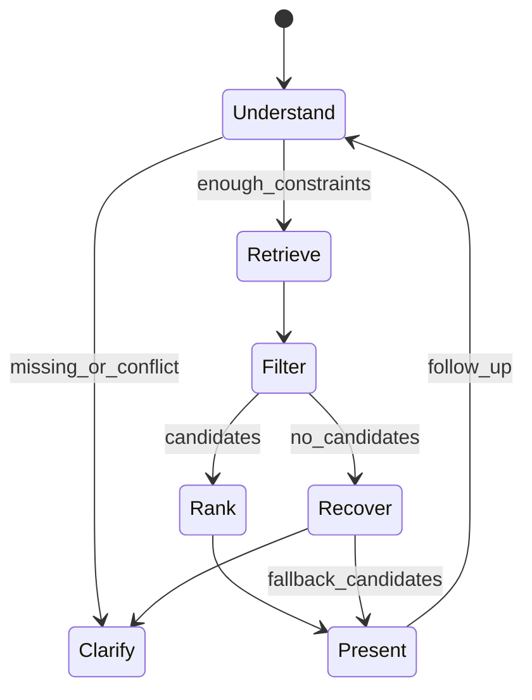

# 系统概要设计

## 1. 设计原则

事实和硬约束由数据/代码负责，模型负责理解与表达；所有异步结果通过共享事件契约传递；数据源、测试夹具和模型输出分层；首版优先可本地复现和可观察。

## 2. 总体架构

已确认采用前后端分离，后端为核心。前端 React/TypeScript + Ant Design，后端 FastAPI；通过 HTTP JSON API 通信，流式回复用 SSE（已实现 `POST /api/chat/stream`）。前后端分别构建、启动和部署；开发环境限制 CORS 到配置的前端来源，部署时可用反向代理统一入口。

建议目录为 `frontend/`、`backend/`、`docs/`。SQLite 存储商品与会话，JSON 是导入格式和测试夹具格式。会话消息、约束和当前商品持久化，重启后通过 API 恢复。浏览器不直接访问数据库或模型服务。

后端独立提供完整 API 和离线评测入口，无需启动前端即可验证核心能力。接口模型由后端维护并导出 OpenAPI，前端据此同步 TypeScript 类型。模型服务地址、模型名和密钥仅在后端配置；兼容能力在接入时验证。




## 3. 模块边界

- `web`：消息列表、输入、快捷选项、卡片、加载/失败状态；不实现商品事实判断。
- `api`：鉴权边界（本地可简化）、请求校验、事件流、错误协议。
- `orchestrator`：维护任务目标和槽位；决定澄清、查询、比较、回退；不直接拼接未验证商品事实。
- `tools`：`search_products`、`filter_variants`、`get_product_facts`、`compare_products`；返回结构化结果与证据。
- `catalog`：统一商品模型、来源和更新时间；真实数据适配器与 synthetic fixture 明确隔离。
- `evaluation`：金标任务、回放、指标计算、失败分类和策略版本。

## 4. 核心数据模型

```text
Conversation {
  id, category?, goal, constraints{}, current_product_id?, messages[],
  status, created_at, updated_at
}

Product {
  product_id, category, brand, title, attributes{}, variants[],
  sources[], facts_updated_at, data_kind: verified|fixture
}

Variant { sku_id, color?, size?, specs{}, price?, available? }

Evidence { source_id, source_url?, field, captured_at, confidence, status }

Recommendation {
  product_id, variant_id?, hard_match, soft_score,
  reasons[], tradeoffs[], evidence[], missing_fields[]
}
```

## 5. 事件契约

统一事件：

```json
{"event_id":"e1","conversation_id":"c1","type":"assistant.text","seq":3,
 "payload":{"text":"我先确认预算"},"created_at":"2026-10-17T00:00:00Z"}
```

首版事件类型：`conversation.started`、`user.message`、`assistant.text`、`clarification.requested`、`tool.started`、`tool.result`、`recommendation.card`、`comparison.card`、`facts.unverifiable`、`error.retryable`、`conversation.completed`。

前端必须按 `conversation_id + seq` 去重并按序处理；未知事件保留日志，不阻塞会话。

## 6. API 草案

- `POST /api/conversations`：创建会话，可传 `category`。
- `POST /api/conversations/{id}/messages`：提交用户消息，返回完整事件列表。
- `POST /api/conversations/{id}/messages/stream`：同一请求体的 SSE 版本，逐事件下发；当前实现为 `POST /api/chat/stream`，事件名 `conversation.started`/`assistant.delta`/`assistant.text`/`error`/`conversation.completed`。生成中途失败只能用 `error` 事件表达，不改 HTTP 状态码，且不落半轮历史。
- `GET /api/conversations/{id}`：读取当前目标、约束、消息摘要。
- `POST /api/conversations/{id}/reset`：重置会话。
- `GET /api/products/{product_id}`：读取带证据的商品事实。
- `POST /api/evaluate/runs`：运行评测任务集，返回 `run_id`。
- `GET /api/evaluate/runs/{run_id}`：读取逐案例结果与汇总指标。

错误结构：`{"code":"NO_MATCH|FACT_UNVERIFIABLE|TIMEOUT|MODEL_ERROR","message":"...","retryable":true,"trace_id":"..."}`。

## 7. 对话编排状态机



终止条件：达到可操作候选/比较结果，或已经明确无法核实并给出下一步。模型不得绕过工具直接生成商品事实。

## 8. 可靠性与安全

- 工具调用设置超时、有限重试和幂等 `trace_id`。
- 模型不可用时返回规则化澄清/查询结果；目录不可用时明确服务错误。
- 日志记录事件类型、耗时、数据源 ID 和错误码，不记录密钥；用户原文按配置脱敏。
- 数据更新时间进入缓存键；过期/冲突字段进入 `missing_fields` 或 `unverifiable`。
- 真实数据和 `fixture` 在目录查询层用 `data_kind` 隔离，生产模式禁止 fixture。

## 9. 测试与评测设计

单元测试覆盖槽位更新、硬过滤、排序解释、证据边界和事件去重；接口测试覆盖错误协议和超时；端到端案例覆盖三品类、预算变更、无匹配、缺失事实和比较。评测输出 JSON/Markdown，保存数据版本、策略版本、模型版本、运行时间和逐案例证据。

## 10. 分阶段实现建议（设计通过后）

1. 后端优先：完成会话持久化、编排、商品工具与独立 API 验证。P0 契约：目录模型、事件模型、API schema、测试夹具。
2. P0 纵向切片：空会话 → 澄清 → 服饰候选卡 → 失败回退。
3. 扩展鞋履/数码及专有属性工具。
4. 接入正式数据源并建立证据检查。
5. 补齐评测、日志、启动文档和课堂验收脚本。
